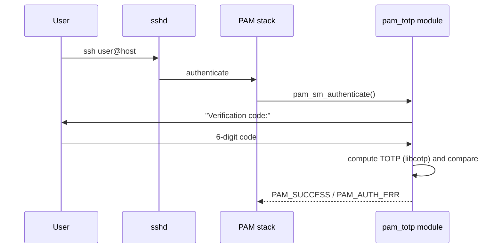

# pam-totp — TOTP two-factor authentication for Linux (PAM module in C)

A Linux-PAM module that adds **time-based one-time passwords (TOTP)** as a second factor, for example on SSH logins — plus a management tool that provisions users with a **QR code** scannable by any authenticator app.

> Built for an IT security course, team of 2 — I wrote most of the code.

<!-- TODO: add a GIF/screenshot: SSH login asking for the verification code, and the QR provisioning -->

## How it works



## Features

- PAM `auth` module written in C (`pam_sm_authenticate`)
- TOTP generation and validation using **libcotp**
- Management tool: creates a per-user secret and shows it as a **QR code**
- Tested with SSH on an Ubuntu VM

## Build

```bash
# TODO: replace with your real dependencies and Makefile targets
sudo apt install libpam0g-dev libcotp-dev
make
sudo make install   # installs the .so into the PAM modules directory
```

## Configuration

Add the module to the SSH PAM stack, in `/etc/pam.d/sshd`:

```
auth required pam_totp.so   # TODO: use your real module name/options
```

And enable keyboard-interactive auth, in `/etc/ssh/sshd_config`:

```
KbdInteractiveAuthentication yes
```

## Provisioning a user

```bash
# TODO: real command of your management tool
./totp-manager add <user>   # prints a QR code to scan with an authenticator app
```

## Security notice

Educational project. It has not been audited — do not use it to protect production systems.

## What I learned

PAM architecture (module types, control flags, stack configuration), C systems programming, and how TOTP (RFC 6238) works end to end.
